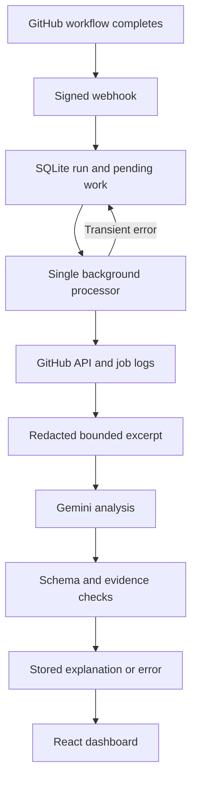
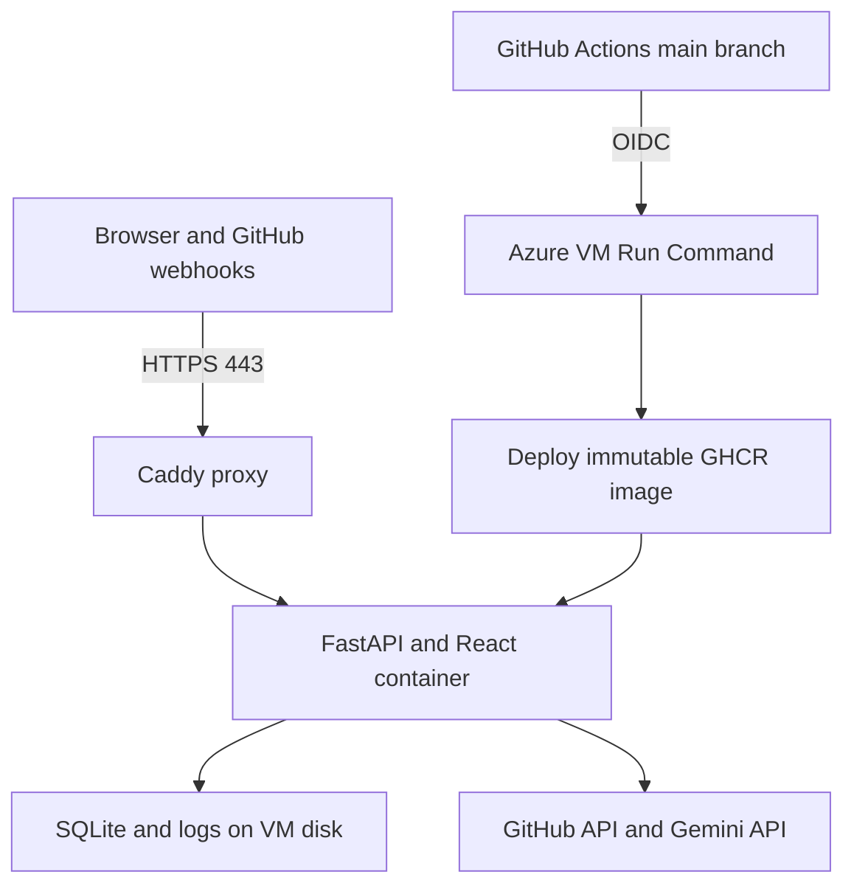

# 6. Architecture and project explanation

## Data flow

The webhook handler verifies the HMAC signature and commits a record before responding. It does not wait for GitHub log downloads or an LLM response. The application polls SQLite for pending work and processes one run at a time. This gives the small demo durable work tracking without introducing SQS, Redis, or another queue service.

GitHub's event payload is used for initial display, but the processor retrieves the specific run attempt from GitHub before analysis. It fetches jobs for that attempt, then downloads plain-text logs for failed jobs. Using job logs avoids handling a ZIP archive of untrusted log filenames.

## Two different statuses

| Field | Examples | Meaning |
|---|---|---|
| `conclusion` | success, failure, timed_out, cancelled | GitHub's workflow outcome |
| `state` | pending, processing, completed, inconclusive, error, not_required | CloudPulse's processing outcome |

A failed build with a Gemini timeout is `conclusion=failure`, `state=error`. A successful build is `conclusion=success`, `state=not_required`.

## Identity and duplicate handling

Each build record has a unique `(repository, run_id, run_attempt)` key. GitHub delivery IDs are also recorded for duplicate visibility and pruned after 30 days. Run records remain until the operator removes/archives the database. A redelivery does not add another record. A rerun creates a new attempt record.

The worker atomically claims pending work. On application startup, interrupted processing records return to pending. This recovery model requires exactly one running app instance/worker. It is not a multi-instance distributed queue.

## Evidence and uncertainty

Log lines keep IDs such as `job12345:L81`. The excerpt preserves their original source line numbers but may remove ANSI formatting and timestamp prefixes, truncate long lines, and redact sensitive text. The model returns IDs; the server reconstructs the displayed quotes from its own excerpt rather than trusting model-written quotations.

The selected excerpt prioritizes error keywords with nearby context and late log lines. It is heuristic. It can miss unusual causes. If any requested evidence ID is invalid, if no supporting IDs exist, or if Gemini declares insufficient evidence, the server reports an inconclusive result and withholds the proposed diagnosis. A valid ID proves only that the line exists in the provided excerpt, not that the explanation is correct.

## Gemini boundary

Only configured metadata and bounded excerpts go to the Gemini Developer API. No tools, code execution, web search, automatic repair, or repository write permissions are given to the model. The structured response includes:

- Failure category
- Probable root cause
- Evidence IDs
- Suggested fix
- Qualitative uncertainty
- Insufficient-evidence flag

Qualitative uncertainty is the model's judgment, not a statistically calibrated confidence probability. The app does not label it as predictive confidence.

Raw provider outputs are not exposed before schema validation. Known application secrets and common token/password patterns are redacted before saving logs or sending excerpts, and known secrets are also removed from displayed narrative fields. Redaction is best effort: avoid printing secrets in your CI workflows in the first place. Google's data-use rules differ by service/tier; use only your public demonstration logs and review your Google project's terms before sending other data.

## API

All `/api/*` endpoints require `Authorization: Bearer <DASHBOARD_TOKEN>`. The webhook uses its separate HMAC secret. The frontend is built into the same image and served at the same origin, so no permissive CORS setup is needed.

| Method/path | Purpose |
|---|---|
| `GET /healthz` | Public minimal server/worker health |
| `POST /webhook/github` | Signed GitHub ping/completion event |
| `GET /api/config` | Repository list and non-secret configuration status |
| `GET /api/stats` | Counts for the overview cards |
| `GET /api/runs?limit=25&offset=0&conclusion=failure` | Paginated run history |
| `GET /api/runs/{id}` | Detailed metadata, jobs, excerpt, and analysis |
| `POST /api/import` | Import a completed run using repository and GitHub run ID |
| `POST /api/runs/{id}/retry` | Queue analysis again for an eligible record |

`{id}` in the detail/retry API is the internal record ID, not GitHub's run ID. `/api/import` accepts JSON `{"repository":"owner/repo","run_id":12345}`. Imports use the latest attempt and preserve an existing record. Retry does not rerun the GitHub workflow; it only reruns CloudPulse processing and may consume Gemini quota.

## Azure topology

Only Caddy publishes web ports. The application process runs as container UID 10001. Its data directory is mounted outside the container. SSH is restricted to the administrator's public IPv4 `/32`. Terraform's optional managed identity trusts only the application's `main` branch and has a role scoped to this VM.

The deployment script pulls a new image first, replaces the application container, waits for health, and restores the previous image if startup fails. There is brief downtime. There are no deployment slots, load balancers, zero-downtime guarantees, or automatic database migration/rollback system. Backend schema is version 1; future schema changes need an explicit migration plan.

## Original proposal versus delivered scope

| Proposed element | Part 1 package |
|---|---|
| GitHub Actions integration | Implemented as completed-run webhooks and REST retrieval |
| Log ingestion | Failed-job logs and bounded excerpts, stored on VM disk |
| LLM root-cause assistance | Gemini API, structured output, source evidence checks |
| Web dashboard | React run list/detail views |
| Cloud hosting | Azure replaces AWS per your account availability |
| Docker, Terraform, own CI/CD | Source/configuration supplied; must be exercised in your accounts |
| ML failure prediction | Deferred |
| Fine-tuned LLM | Deferred; uses an existing model |
| SNS/email/Slack alerts | Deferred |
| S3/Blob object storage, managed DB, managed queue | Deferred |
| Real-time streaming of active logs | Deferred; processing begins after completion |
| Automatic remediation/self-healing | Deferred; suggestions need human review |

## Known practical limits

- Single instance, local SQLite, and a shared dashboard token suit a small student demonstration.
- The configured GitHub token is required for reliable log access; logs can be delayed or expire.
- Up to five failed jobs are analyzed by default, with a 5 MB download limit per job and approximately 14,000 excerpt characters including line-reference overhead. JSON/metadata add some overhead.
- The excerpt may miss a relevant section in a very large or unusual log.
- Provider outages, quota, model availability, response schema changes, or weak model output can prevent a useful explanation.
- Background work is recoverable, but one Gemini request may be billed more than once after interruption/retry.
- Data is not replicated. Back up the VM's data before replacing/deleting infrastructure.
- No retention job automatically deletes old logs or container images. Monitor disk space during extended use.
- Source was reviewed but not executed for this delivery; your acceptance checklist is the verification record.

## Official references consulted

- [GitHub webhook events and payloads](https://docs.github.com/en/webhooks/webhook-events-and-payloads)
- [Validate webhook deliveries](https://docs.github.com/en/webhooks/using-webhooks/validating-webhook-deliveries)
- [Workflow runs REST API](https://docs.github.com/en/rest/actions/workflow-runs)
- [Workflow jobs REST API](https://docs.github.com/en/rest/actions/workflow-jobs)
- [Gemini API key setup](https://ai.google.dev/gemini-api/docs/api-key)
- [Gemini generateContent API](https://ai.google.dev/api/generate-content)
- [Gemini structured output](https://ai.google.dev/gemini-api/docs/generate-content/structured-output)
- [Azure public IP DNS labels](https://learn.microsoft.com/en-us/azure/virtual-network/ip-services/public-ip-addresses)
- [Azure GitHub OIDC](https://learn.microsoft.com/en-us/azure/developer/github/connect-from-azure-openid-connect)
- [Azure VM Run Command](https://learn.microsoft.com/en-us/azure/virtual-machines/run-command-overview)
- [App Service storage-mount limitations](https://learn.microsoft.com/en-us/azure/app-service/configure-connect-to-azure-storage)
- [Caddy automatic HTTPS](https://caddyserver.com/docs/automatic-https)
- [AzureRM Terraform provider](https://registry.terraform.io/providers/hashicorp/azurerm/latest/docs)
